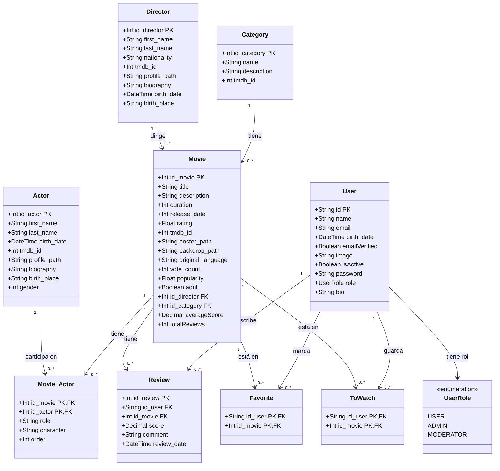

# CRITIO

## Grupo
### Integrantes
* 53533 - Bonadeo, Juan Cruz
* 52674 - Casermeiro, Gonzalo
* 53543 - De la rosa, Valentin
* 52245 - Krichman, Tomas

### Repositorios
* [Frontend app](https://github.com/JuanBonadeo/FrontEnd-TPDSW)
* [Backend app](https://github.com/JuanBonadeo/Backend-TPDSW)

### Deploy en vercel
* [Critio](https://critio.vercel.app)

## Tema
### Descripción
Critio es una plataforma web donde las personas pueden registrarse para calificar y reseñar películas. La idea de la aplicación es ayudar a los usuarios a elegir su próxima película basandose en críticas de otros. 
La página permite buscar por título y filtrar por categorías. Cuenta con páginas dedicadas con la bibliografia de cada actor y director, mostrando las películas donde participa.
Los usuarios cuentan con dos listas personalizadas, Favoritas y WatchList.
Cuenta con panel de administración para gestionar los usuarios registrados.

### Modelo

## Alcance Funcional 

### Regularidad y Aprobacion Directa

|Req|Detalle|
|:-|:-|
|CRUD simple|1. CRUD Pelicula 2. CRUD Director 3. CRUD Actor 4. CRUD Categoria 5. CRUD Usuario|
|CRUD dependiente|1. CRUD Reseña 2. CRUD Favorito 3. CRUD Watchlist 4. CRUD Pelicula-Actor|
|Listado + detalle|1. Listado de películas filtrado por categoría 2. Listado de películas favoritas 3. Listado de películas en la Watchlist 4. Listado de Reseñas por Pelicula 5. Listado de Reseñas por Usuario|
|CUU/Epic|1. Reseñar pelicula/serie 2. Calificar reseña de otro usuario 3. Admin Panel (peliculas, reviews, usuarios) 4. Seed de peliculas con TMDBAPI 5. Cargar ultimas 20 peliculas mas populares, con TMDBAPI|
