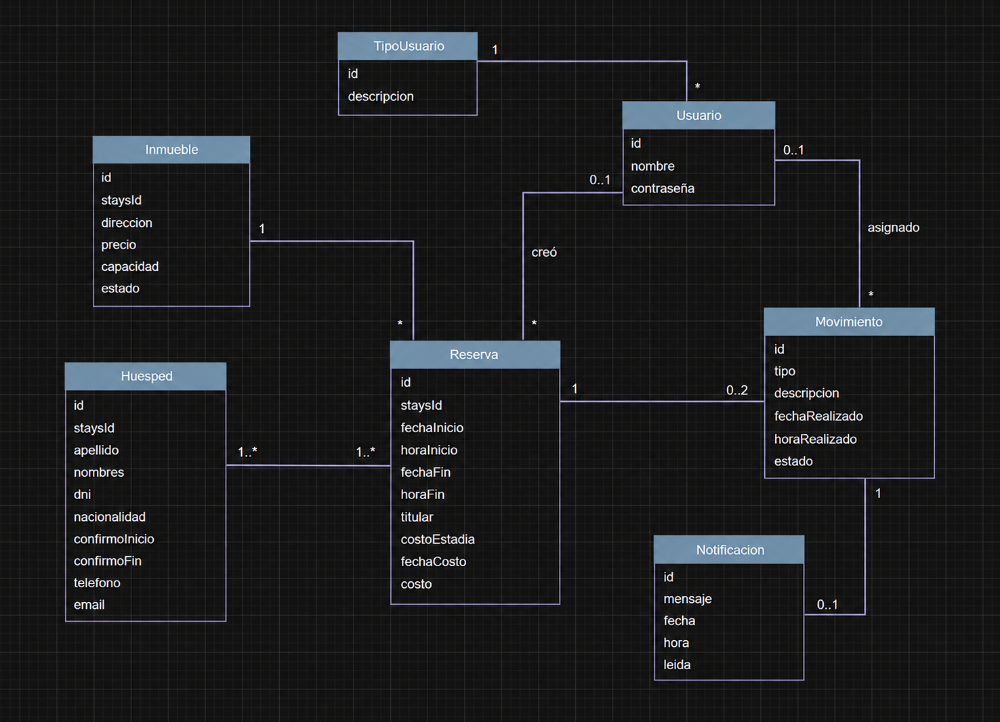

# Propuesta TP DSW

### Integrantes
* 44123-Milanesi Renzo
* 46291-Gamba Emiliano Francisco

### Repositorios
*  [FRONTEND app](https://github.com/gitgamba/DSW-FRONTEND-2026)
* [BACKEND app](https://github.com/gitgamba/DSW-BACKEND-2026)
* [Video de muestra](https://drive.google.com/file/d/1mR5La6TuBtTh3pgdFKk5MSmzHmg5TrIQ/view?usp=sharing)
* [Aplicación publicada](https://dsw-frontend-2026.vercel.app/login)

### Credenciales de prueba
|Rol base|Usuario|Contraseña|
|:-|:-|:-|
|Administrador|admin|admin123|
|Supervisor|supervisor|supervisor|
|Operador (Limpieza)|limpieza|limpieza|

> La API y la base están en planes gratuitos: el primer login puede tardar hasta un minuto mientras se despiertan.

## Tema
### Descripción
Vamos a crear un Sistema de Gestión Web que va a permitir administrar una agenda de operadores de una empresa de hospedaje.

Las reservas, inmuebles y huéspedes se obtienen de [Stays](https://stays.net), un channel manager que centraliza las reservas de Booking, Airbnb y otras plataformas. El sistema se conecta a la API de Stays (ya contamos con usuario y acceso habilitado) y sincroniza los datos a demanda.

Con esas reservas se arma una agenda de check-ins y check-outs: cada reserva genera dos movimientos (check-in y check-out) y cada movimiento se asigna a un operador, que recibe una notificación dentro de la aplicación.

#### Roles base y tipos de usuario
|Tipo|Qué puede hacer|
|:-|:-|
|Administrador|Administrar usuarios, tipos, inmuebles, huéspedes y reservas; sincronizar Stays y gestionar/asignar movimientos.|
|Supervisor|Consultar reservas y gestionar/asignar movimientos.|
|Operador|Ver su agenda, recibir las notificaciones de los movimientos asignados y marcarlos como realizados.|

Los roles base son tres valores fijos de `TipoUsuario.rolBase`, no tablas ni nombres de puestos.
Cada tipo conserva una descripción editable (por ejemplo Limpieza, Recepción o Mantenimiento).
Los tipos iniciales también se pueden editar, pero no se puede dejar al sistema sin administradores.
Un cambio de rol se aplica a sus usuarios al volver a iniciar sesión.

No hay registro público: el primer administrador se crea con un seed y es quien da de alta al resto de los usuarios.

### Modelo

La imagen conserva el diagrama publicado anteriormente. La implementación actual
incorpora `TipoUsuario.rolBase`, `Usuario.passwordHash`, moneda de la estadía y
reservas con cero o más huéspedes; estas precisiones se describen en esta propuesta.

### Tecnologías

|Parte|Tecnologías|
|:-|:-|
|Backend|Node.js, Express, TypeScript, Zod, Prisma, SQL Server (Azure SQL), JWT + bcrypt, Jest|
|Frontend|React, Vite, TypeScript, React Router, React Bootstrap, FullCalendar|
|Deploy|API en Render, frontend en Vercel, base en Azure SQL|
|Integración|API externa de Stays|

Tecnologías distintas a las dadas en la cátedra :
* **Prisma 6** en lugar de MikroORM: el equipo ya lo conoce y utiliza su esquema central para generar el cliente tipado, definir relaciones y versionar migraciones. Su conector SQL Server permite trabajar con la base elegida. Esta elección no implica que MikroORM carezca de soporte para SQL Server.
* **SQL Server (Azure SQL)** en lugar de MySQL: es la base que ya conocemos; utilizamos una instancia compartida en la nube dentro de la oferta gratuita configurada para el proyecto.

## Alcance Funcional

### Alcance Mínimo

Regularidad:
|Req|Detalle|
|:-|:-|
|CRUD simple|1. CRUD Tipo de usuario 2. CRUD Inmueble|
|CRUD dependiente|1. CRUD Usuario que depende de Tipo de usuario 2. CRUD Movimiento que depende de Reserva y del Usuario asignado|
|Listado + detalle| 1. Listado de reservas, filtrado por fecha, inmueble y usuario asignado => detalle CRUD 2. Listado de hoja de ruta por usuario|
|CUU/Epic|1. Generar agenda por usuario 2. Emitir notificaciones a los responsables de los movimientos|

Adicionales para Aprobación
|Req|Detalle|
|:-|:-|
|CRUD |1. CRUD Huésped 2. CRUD Reserva que depende de Inmueble y permite asociar huéspedes 3. Gestión automática de Notificación dependiente de Movimiento: emisión, reasignación, consulta, marcado de lectura y eliminación al desasignar o borrar el movimiento|
|CUU/Epic|1. Sincronizar reservas, inmuebles y huéspedes desde Stays 2. Generar agenda de check-in y check-out (vista de lista por día y vista de calendario) 3. Asignar y reasignar usuarios a los movimientos (puede darse el caso de que un usuario no pueda ir a hacer el check-in y deba asignarse otro) 4. Notificar al usuario los datos del check-in / check-out|
|Otros|1. Login y permisos por tipo de usuario (Administrador, Supervisor, Operador)|

### Alcance Adicional Voluntario

Las funcionalidades de esta sección no forman parte de la implementación actual.

|Req|Detalle|
|:-|:-|
|Listados |1. Resumen mensual (inmuebles más alquilados, promedio de duración de reservas) 2. Listado de reservas por inmueble o usuario|
|CUU/Epic||
|Otros|1. Permisos por usuario (además de por tipo de usuario)|

## Validación y entrega

- Tests backend: unitarios y una integración de asignación/notificación.
- Tests frontend obligatorios para aprobación: componente con Vitest y E2E con Playwright contra API local real.
- [Frontend publicado](https://dsw-frontend-2026.vercel.app).
- [Health de API publicada](https://dsw-backend-2026.onrender.com/api/health).
