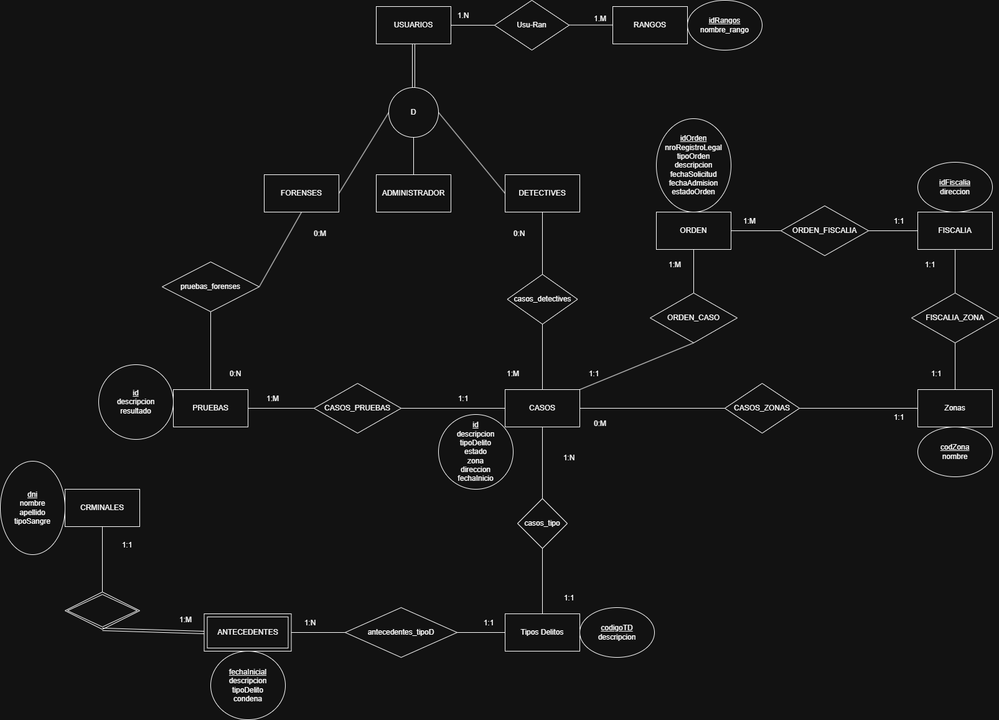

# Propuesta TP DSW

## Grupo
### Integrantes
50968 Chocobar, Carlos Maximo  
47340 Tarantola, Federico 
50309 Taborda, Astudilla Santiago

### Repositorios
* [frontend app](https://github.com/ChocobarCM/tp-dsw-frontend.git)
* [backend app](http://hyperlinkToGihubOrGitlab)
*Nota*: si utiliza un monorepo indicar un solo link con fullstack app.

## Tema- Gestión de Casos Criminales-

### Descripción
Plataforma web full-stack diseñada para la centralización y seguimiento de investigaciones delictivas en la ciudad. El sistema permite a las fuerzas de seguridad gestionar expedientes, catalogar evidencias vinculadas y administrar el cuerpo de oficiales, facilitando la visualización de datos críticos para la resolución de crímenes

### Modelo De Relacion

## Alcance Funcional 

### Alcance Mínimo

*Nota*: el siguiente es un ejemplo para un grupo de 3 integrantes para un sistema de hotel. El 

Regularidad:
|Req|Detalle|
|:-|:-|
|CRUD simple|1. CRUD Tipo de Delito 2. CRUD Oficial/Detective 3. CRUD Ubicación/Zona|
|CRUD dependiente|1. CRUD Caso Criminal (depende de Tipo de Delito)  2. CRUD Evidencia (depende de Caso Criminal)|
|Listado + detalle| Listado de Casos filtrado por Zona => detalle del Caso y Oficial asignado.  2. Listado de Oficiales por Estado (Activo/Inactivo) => detalle de casos resueltos por el oficial.|
|CUU/Epic|1. Confección, Apertura de nuevo expediente criminal, Auditoría de movimientos y cambios de estado en un caso.  2. Asignacion de oficial Inteligente|

Adicionales para Aprobación
|Req|Detalle|
|:-|:-|
|CRUD |1-Tipo de evidencia. 2.Estado de caso.  3- Fiscalias.  4- Turnos |
|CUU/Epic|1. **Gestión de Análisis Forenses:** Un detective solicita un análisis sobre una evidencia vinculada a un caso. Un usuario con rol "Perito" procesa la solicitud, carga los resultados técnicos y cierra el dictamen. 2. **Solicitud y Aprobación de Órdenes Judiciales:** El detective redacta una solicitud de allanamiento o arresto justificada por evidencia/peritajes. Un usuario con rol "Juez/Fiscal" la evalúa en su bandeja y la marca como Aprobada o Rechazada. 3. **Motor de Búsqueda Forense (Simulación CODIS):** A partir del análisis forense, el sistema escanea la base de datos de criminales registrados, aplicando un algoritmo de coincidencia genética para identificar sospechosos y calculando el porcentaje de compatibilidad.|

### Alcance Adicional Voluntario

*Nota*: El Alcance Adicional Voluntario es opcional, pero ayuda a que la funcionalidad del sistema esté completa y será considerado en la nota en función de su complejidad y esfuerzo.

|Req|Detalle|
|:-|:-|
|Listados |1- Inventario de evidencia clasificada => Listado el cual muestra la evidencia y su caso.   2- Casos sin resolver. => Casos los cuales cuente con 6 meses o mas sin activadad seran archivado y mostrada en una lista por aparte.|
|CUU/Epic|1. a definir|
|Otros|1. a definir|

